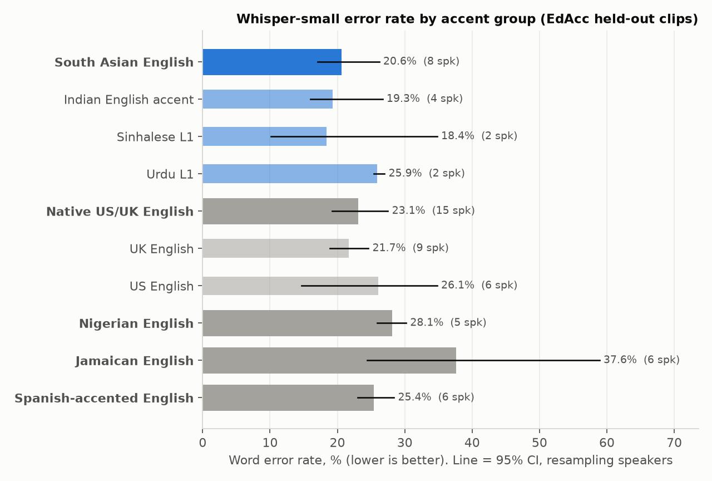
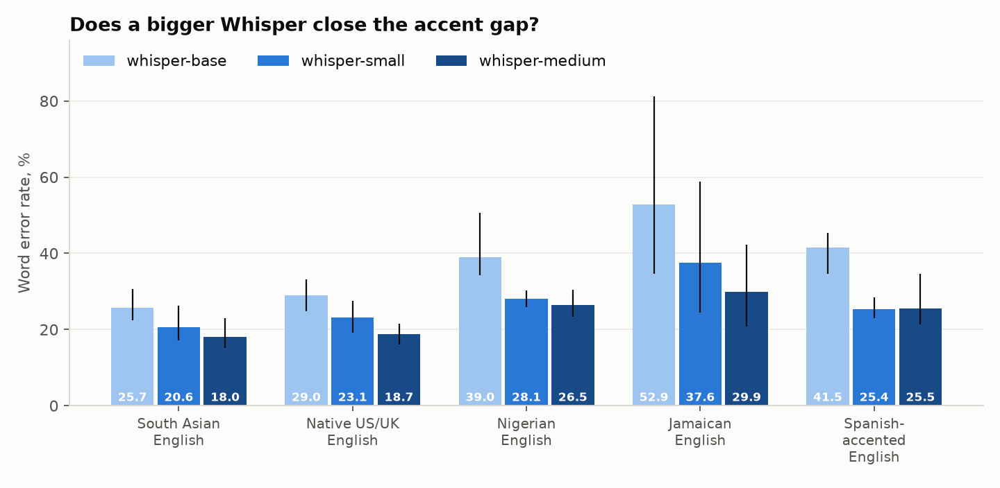
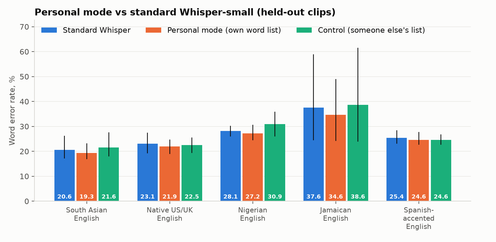
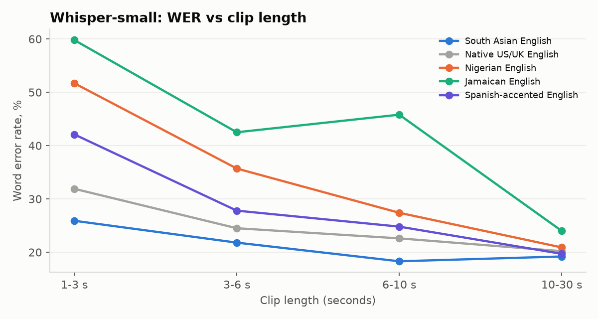

# Accent Gap
**Track:** Languages
**Team:** Karan Daryanani

> Every number below comes from a file in [`results/`](results/) produced by the code in this repo.
> The file is named next to each number. **Video demo: https://youtu.be/ocqcZuP6GJk**

## The problem

My parents speak Sindhi. When I dictate a text, Siri types it perfectly. When my mom
dictates the same kind of message on the same phone, it comes out garbled, and Alexa
often doesn't understand my parents at all. Speech-to-text is now how many people
text, search and use their phones, so when it works worse for some accents, those
people get a worse phone. They have to repeat themselves, correct every message, or
give up on voice features. I wanted to measure how big this "accent gap" really is for
South Asian-accented English in a modern open speech model, find out which words it
gets wrong, and test whether a phone could cheaply adapt to one person ("mom mode").

## What we built

A measurement pipeline and a prototype "personal mode" around **OpenAI Whisper**, an AI
speech-to-text model:

1. **Accent-gap benchmark.** We run Whisper on 1,628 held-out clips (166.9 minutes) from 40
   speakers in the public EdAcc corpus. That covers 8 South Asian, 15 native US/UK and 17
   Nigerian/Jamaican/Spanish-accented speakers (`results/set_totals.csv`, `results/eval_set_summary.csv`). We report
   word error rate (WER) per accent group, per sub-group and per speaker, with confidence
   intervals.
2. **Personal mode.** For each speaker we build a 40-word "personal word list" from the
   *earlier* part of their conversation. We give it to Whisper as a text prompt and test on
   the *later* part. A **loop guard** catches the repetition loops that prompts can
   cause.
3. **Error analysis.** Which words are missed, whether names and numbers fail more often,
   how clip length matters, and the worst clips side by side with our best guess at why.
4. **Demo** (`demo.py`, Gradio). Press record, talk, and press stop; nothing needs typing.
   - It **detects the language you spoke** (Whisper) and writes down what you said.
   - With *learn my words* on, it builds your personal word list **automatically** from what you
     said earlier in the session. This is the same personal-mode recipe we evaluated, used only for
     English and whisper-small, where it helped.
   - It **translates** the text into one of 30 languages, including Sindhi, Hindi, Urdu and French,
     with Meta's NLLB-200 translation model. A Scottish-accented English sentence can come out in
     French, or my mom's English in Sindhi.
   - It **speaks the translation in your own voice**, copied from your recording by Resemble AI's
     Chatterbox Multilingual voice-cloning model (23 languages, including French, Spanish, Hindi and
     Arabic, but not Sindhi or Urdu). It then **checks the audio**: Whisper-medium listens to the
     spoken translation, and any part whose characters differ from the translation by more than 15%
     is generated again, up to 3 times. The demo shows what Whisper heard, the mismatch, and a
     voice-match score. The audio is AI-generated and carries the model's invisible watermark.
   - A second tab plays real EdAcc test clips side by side (standard vs learned words, mistakes
     highlighted), translates them and speaks the translation in that EdAcc speaker's voice, so it
     works without a microphone.

   We did **not** measure translation quality or language detection accuracy. We *did* measure
   whether the spoken audio says the translated text and how close the voice is (section 3c).
   Everything else measured below is about English speech-to-text.

**Who it's for:** people with South Asian accents, like my mom, who dictate everyday
messages. The real target is the phone or speech-to-text maker, who could add a personal
mode.

**What goes in / what comes out (a real held-out example, `results/worst_examples.csv`):**
- *In:* a 1.2-second clip from a Sinhalese-L1 speaker (EDACC-C10-84) + this speaker's word
  list from earlier in the conversation (`play, played, used, chocolate, cricket, favorite, ...`)
- *Out:* Standard Whisper: **"No, contrary to that."** Personal mode: **"No, I can't remember."**
  The reference is "no I can't remember", so WER went from 80% to 0%.

## What we added

We built on the suggested "speech recognition across accents" project and added:
- **Our own user:** South Asian-accented speakers dictating everyday messages, motivated by my mom.
- **Our own question:** does per-speaker personalization close the accent gap?
- **A leak-free design.** Each speaker's conversation is split in time order. The first 60% is
  "history", and only its *text* is used to build the word list. The last 40% is the only thing
  we score. No model ever transcribes a history clip.
- **A control baseline.** We also give Whisper *someone else's* word list (a speaker of the same
  accent group from a different conversation). This tells us whether gains come from
  *personal* words or from prompting in general.
- **A dev set for design choices.** When our first version failed, we chose the fix using 32
  *other* EdAcc speakers (Irish, Scottish, Kenyan, South African, Italian, Vietnamese), not the
  test speakers. Then we ran the chosen design once.
- **Speaker-level bootstrap confidence intervals**, per-speaker results, and model-size comparison.

## How it works

```
EdAcc (public, Hugging Face)
  │  scan_metadata.py   read text columns only (no 7 GB download): speakers, accents, first languages
  ▼
prepare_data.py   pick speakers by accent / first language → sort each conversation in time order
  │               first 60% = history (text only), last 40% = eval (≤100 clips/speaker, 1–30 s)
  │               download only the needed audio chunks, resample to 16 kHz mono
  ▼
personal_words.py history text → drop stopwords → words said ≥2 times → top 40 = personal list
  ▼
run_transcribe.py Whisper (base / small / medium), language=English, on eval clips:
  │                 plain  |  personal: prompt "Words I often use: w1, w2, ..."  |  control: someone else's list
  │                 loop guard: if output compresses > 2.4× with zlib (a repetition loop) → use plain output
  ▼
analyze.py        Whisper's English normalizer on both texts → word alignment (jiwer)
                  → WER per group / sub-group / speaker, 2,000× bootstrap resampling speakers,
                  missed words, word types, clip length, worst examples → results/*.csv + *.png
```

- **Model:** `openai/whisper-small` for the main results (also base and medium), run locally
  on a MacBook GPU (Apple MPS). The AI does the core job, speech → text. We never train it:
  personal mode only changes the *prompt*, the text Whisper sees as "what was said before".
- **Metric:** WER = (substituted + deleted + inserted words) / words actually said. Both texts
  go through Whisper's English normalizer first, so "Okay." vs "OKAY" or "20" vs "twenty" is
  not counted as an error.
- **Groups:** South Asian = accent "Indian English" or first language Hindi/Urdu/Sinhalese/etc.
  Native = accent and first language both Mainstream US or Southern British English.

## Results

### 1. The accent gap: on EdAcc, Whisper is NOT worse for South Asian speakers



Whisper-small, held-out clips (`results/wer_by_group.csv`, `results/accent_gap.csv`):

| Group | Speakers | Clips | WER | 95% CI | × native WER (95% CI) |
|---|---|---|---|---|---|
| **South Asian English** | 8 | 356 | **20.6%** | 17.1–26.2 | **0.89** (0.69–1.20) |
| ↳ Indian English accent | 4 | 265 | 19.3% | 16.0–26.7 | |
| ↳ Urdu L1 | 2 | 63 | 25.9% | 25.4–27.0 | |
| ↳ Sinhalese L1 | 2 | 28 | 18.4% | 10.1–34.8 | |
| **Native US/UK English** | 15 | 507 | **23.1%** | 19.2–27.5 | 1 (reference) |
| Nigerian English | 5 | 274 | 28.1% | 25.9–30.2 | 1.21 (1.01–1.47) |
| Jamaican English | 6 | 204 | 37.6% | 24.4–58.9 | 1.63 (1.03–2.60) |
| Spanish-accented English | 6 | 287 | 25.4% | 23.0–28.4 | 1.10 (0.90–1.37) |

**Honest answer to our first question:** on EdAcc we found **no accent gap for South Asian
speakers**. Their WER (20.6%) is slightly *lower* than native speakers' (23.1%), and the
confidence interval for the ratio (0.69–1.20) includes 1, which means no difference. Gaps we
*can* see are for Jamaican English (1.63×) and Nigerian English (1.21×). The spread *between
speakers* is larger than between groups. South Asian speakers range from 10.1% to 34.8% WER,
and native speakers from 3.3% to 39.1% (`results/wer_by_speaker.csv`).

This does **not** mean my mom's experience is wrong. EdAcc's South Asian speakers are fluent,
mostly young English speakers on video calls, two of whom describe their own accent as
"American" (`results/dataset_overview.csv`). My mom is an older Sindhi speaker dictating on a
phone, and Siri is not Whisper. See Limitations.

### 2. Does a bigger model close the gap?



WER by model (`results/wer_by_group_all_systems.csv`, `results/accent_gap.csv`):

| Group | whisper-base | whisper-small | whisper-medium | medium: × native (95% CI) |
|---|---|---|---|---|
| South Asian English | 25.7% | 20.6% | 18.0% | 0.96 (0.77–1.30) |
| Native US/UK English | 29.0% | 23.1% | 18.7% | 1 |
| Nigerian English | 39.0% | 28.1% | 26.5% | 1.42 (1.16–1.74) |
| Jamaican English | 52.9% | 37.6% | 29.9% | 1.59 (1.07–2.32) |
| Spanish-accented English | 41.5% | 25.4% | 25.5% | 1.36 (1.07–1.89) |

Bigger models are better for everyone, but they **do not close the gaps that exist**. With
medium, native speakers improve more than Nigerian and Spanish-accented speakers, so those
ratios *grow* (Nigerian 1.21× → 1.42×, Spanish 1.10× → 1.36× from small to medium). Speed per
clip: base 0.20 s, small 0.27 s, medium 1.14 s (`results/model_speed.csv`; measured while other
jobs shared the GPU).

### 3. Personal mode: a small gain on whisper-small from *personal* words. It does not close an accent gap and backfires on whisper-medium



Whisper-small, final design (sentence prompt + 40 words + loop guard)
(`results/personal_mode_by_group.csv`, `results/personal_vs_control.csv`):

| Group | Standard | Personal mode | Gain (95% CI) | Control (someone else's list) | Personal beats control by (95% CI) |
|---|---|---|---|---|---|
| South Asian English | 20.6% | 19.3% | +1.3 (−1.1 to +4.6) | 21.6% | +2.3 (−0.3 to +6.7) |
| Native US/UK English | 23.1% | 21.9% | +1.2 (−1.7 to +4.5) | 22.5% | +0.6 (−0.5 to +1.7) |
| Nigerian English | 28.1% | 27.2% | +0.9 (−1.5 to +2.5) | 30.9% | +3.7 (+0.6 to +5.9) |
| Jamaican English | 37.6% | 34.6% | +3.0 (−1.7 to +10.2) | 38.6% | +4.0 (−0.1 to +12.6) |
| Spanish-accented English | 25.4% | 24.6% | +0.7 (−0.4 to +1.7) | 24.6% | −0.1 (−1.2 to +0.5) |
| **All 40 speakers** | **25.5%** | **24.3%** | **+1.3 (−0.1 to +2.7)** | 26.1% | **+1.8 (+0.5 to +3.2)** |

(Gain = WER points saved; positive = better. The CIs are paired: the same clips, resampling speakers.)

What this shows:
- **Personal mode helps a little in every group** (+0.7 to +3.0 WER points). Across all 40
  speakers the gain is +1.3 points (5.0% relative). Its 95% CI just touches zero, and 21
  speakers improved while 18 got worse.
- **It is the *personal* words that help.** Someone else's list gives no gain overall (−0.5),
  and the speaker's own list beats it by 1.8 points (95% CI +0.5 to +3.2, which excludes zero).
- **It does not help South Asian speakers more than native speakers.** The difference in gain is
  +0.1 points (95% CI −4.0 to +4.5), so there is no evidence either way
  (`results/personal_mode_gain_comparison.csv`). And since we found no South Asian gap on EdAcc,
  there was no gap for it to close.
- Words that were in a speaker's list are missed less often. South Asian: 13.6% → 11.2% over
  169 occurrences (`results/miss_rate_by_word_type.csv`).

**Our first design failed, and we report it.** Version 1, a bare comma-separated list
of 40 words, made WER *worse* in every group (South Asian −1.8, native −3.0, Jamaican −16.8 points;
`personal_mode_by_group.csv`, rows `personal_v1`). Whisper copied the list format and fell into
repetition loops like "no, no, no, ..." about 100 times. We picked the fix on the 32 dev speakers
only (`results/dev_tuning.csv`). There, plain Whisper scored 21.9% WER, v1 24.9%, and the chosen
sentence prompt + loop guard 21.0%. On the eval clips the loop guard replaced 7 of 1,628
personal-mode outputs (`results/loop_guard_counts.csv`).

**Personal mode depends on the model size, and it backfires on whisper-medium.** We ran the same
final design on all three sizes. All 40 speakers (`results/personal_mode_by_group.csv`,
`results/personal_vs_control.csv`):

| Model | Standard | Personal mode | Gain (95% CI) | Control gain | Personal beats control by (95% CI) |
|---|---|---|---|---|---|
| whisper-base | 35.0% | 33.6% | +1.4 (−0.3 to +3.3) | 0.0 | +1.3 (−0.8 to +2.9) |
| whisper-small | 25.5% | 24.3% | +1.3 (−0.1 to +2.7) | −0.5 | +1.8 (+0.5 to +3.2) |
| whisper-medium | 22.4% | 25.1% | **−2.7 (−3.9 to −1.3)** | −3.6 | +0.9 (−0.3 to +2.1) |

With whisper-medium, *any* word-list prompt makes the model **stop too early**. On long clips it
often writes only "I" or "Yeah.", and deletions go up in every group (South Asian 11.7% → 15.0%,
native 11.3% → 13.6%; `results/wer_by_group_all_systems.csv`, column `del_pct`). Our design was
chosen on dev speakers with whisper-small and **does not transfer** to medium. A real product would
have to tune it per model. Personal words still beat someone else's words on every model size,
though the margin is only significant for small.

### 3b. Stretch (E4): a quick LoRA fine-tune made things worse

We fine-tuned whisper-small with LoRA, a small set of extra trainable weights (0.7% of the model),
for one epoch. Training used 1,254 clips from the 32 dev speakers only (`results/lora_training.csv`), so none of the 40
evaluation speakers were seen (speaker-disjoint; `src/lora_finetune.py`). On the same eval clips
(`results/lora_vs_plain.csv`, `results/insertions_by_system.csv`):

| | whisper-small | + LoRA | Gain (95% CI) |
|---|---|---|---|
| South Asian English | 20.6% | 21.4% | −0.8 (−13.4 to +6.1) |
| Native US/UK English | 23.1% | 26.5% | −3.4 (−13.2 to +5.9) |
| All 40 speakers | 25.5% | 31.2% | **−5.7 (−11.1 to −0.4)** |

The fine-tune learned EdAcc's *style*: it now writes repeated words the way EdAcc does, so
deletions fell from 13.9% to 5.3% of words. But it also started repeating words in loops
("they they they ..."). Clips with 5+ inserted words rose from 17 to 56 out of 1,628, and
overall WER got worse. This was a short, untuned run, so it shows that a naive fine-tune is not
an easy win. It does not show that fine-tuning cannot work.

### 3c. Demo check: is the spoken translation correct, and does it sound like the speaker?

We ran the demo's exact pipeline (`src/voice_check.py`) on 10 held-out EdAcc clips (2 per group,
9 speakers, chosen at random) × 3 languages = 30 spoken translations
(`results/voice_check.csv`, `results/voice_check_summary.csv`).

**Does the audio say the translated text?** Whisper-medium listened to each spoken translation,
and we measured the character mismatch (CER) against the text it was supposed to say:

| | First try | After up to 3 tries | Runs still above 15% |
|---|---|---|---|
| French | 8.6% | 2.2% | 0 of 10 |
| Spanish | 1.8% | 1.8% | 0 of 10 |
| Hindi | 25.1% | 19.4% (median 10.9%) | **2 of 10** |

French and Spanish came out almost word for word. Hindi is clearly weaker: in 2 of 10 runs, the
audio still didn't match after 3 tries. In one, the voice model kept babbling after a sentence
that ended in "...", and the demo shows a "don't trust this audio" warning when that happens.
Part of the Hindi mismatch is Whisper's own spelling (हूँ vs हूं), so the true error is somewhat lower
than measured, but we can't say by how much.

**Does it sound like the speaker?** Voice match = cosine similarity between voice "fingerprints"
(speaker embeddings, 1.0 = identical). Generated speech vs a *different* real clip of the same
speaker scored **0.84** on average. Two real clips of the same speaker scored **0.84**, and real
clips of two different speakers scored **0.65**. In all 30 runs, the generated voice was closer to
the speaker's real voice than a different speaker's voice was. Caveat: the voice encoder used to
score this is the same one the voice model is guided by, so it may flatter the result. **No human
listening test was done.**

A spoken translation took 18 s to make on average, for 5.1 s of audio. We still did **not**
measure whether the translation itself is correct: this check only confirms that the audio says
what NLLB wrote.

### 4. Where it fails: side-by-side examples

Errors by word type, whisper-small (`results/miss_rate_by_word_type.csv`):
- **Rare words** (names, places, unusual words; low frequency in everyday English) are missed far
  more often than common words. South Asian 49.5% vs 18.3%, native 43.9% vs 21.0%.
- **Most errors are deletions** of small words in fast conversational speech: South Asian 12.8%
  deletions vs 6.2% substitutions; native 13.9% vs 7.5% (`results/wer_by_group.csv`). The most-missed
  words in every group are "i", "you", "the", "like" and "know" (`results/missed_words_by_group.csv`).
  Whisper tends to write a cleaned-up sentence, while EdAcc transcribes every repeated "I I I".
- **Short clips are much harder.** For 1–3 s clips WER is 25.9% (South Asian), 31.9% (native) and
  59.8% (Jamaican). For 10–30 s clips all groups are between 19.2% and 24.0% (`results/wer_by_length.csv`).
  Most of the gap for the other accents comes from short clips with little context.



Real held-out clips (`results/worst_examples.csv`; "why" = our best guess, to be checked by listening):

| Clip (group) | What was said (reference) | Standard Whisper | Personal mode | Why we think it failed |
|---|---|---|---|---|
| C10-84 (South Asian, Sinhalese L1) | no I can't remember | No, contrary to that. | No, I can't remember. | 1.2 s and quiet (−30.3 dB), so very little sound to go on; the prompt's context helped |
| C07-217 (native US) | some of them are I can't really I don't have any at the top of my mind right now ... | `,` (only a comma) | Some of them are, I can't really, I don't have any at the top of my mind right now ... | Not an accent error: Whisper stopped decoding immediately on a 12.6 s clip; WER 100% → 8.9% with the prompt |
| C41-129 (Nigerian) | peanuts burger can you make peanuts burger | Pinozboga, Kainmek Pinozboga. | Pinozburger, can make Pinozburger. | Whisper spelled the sounds as a new word; an unusual phrase in a 1.9 s clip with no context |
| C52-312 (Jamaican) | me prefers Naruto more than Dragon Ball Z | I prefer to know what's off with my underground boundary. | I prefer to know what's off, with my android and battery. | Rare names + Jamaican Creole grammar; Whisper "corrects" toward common English phrases |
| C09-358 (South Asian, Indian English) | I think we should also like | What? | **Words I often use.** | **Our method's failure:** on a short unclear clip, Whisper echoed our own prompt (1 of 1,628 clips) |
| C09-362 (South Asian) | this call forty minutes about it | It's cause we've talked 40 minutes about that. | (same) | Possibly a *reference* error: Whisper's sentence may be what was actually said |

Personal mode can also *hurt*. On EDACC-C05_P1-195 the standard output was nearly perfect
("cool and stuff you know and I needed an extra jacket ... 26 is like what?", WER 10%), but personal
mode stopped after one word, "cool." (WER 100%) (`results/all_clips_side_by_side.csv`).

### Limitations (please read)
- **EdAcc is not my mom.** These are public speakers in relaxed video-call conversations, not
  older Sindhi speakers dictating texts on a phone. Our results say nothing direct about Siri
  or Alexa, which are different systems.
- **Small groups.** Only 8 South Asian speakers exist in EdAcc that we could use: 4 with an Indian
  English accent, 2 Urdu-L1 speakers who self-describe as American-accented, and 2 Sinhalese-L1.
  No Sindhi speakers at all. That is why the confidence intervals are wide. "No gap found" is
  not the same as "no gap exists".
- **Conversation ≠ dictation.** In a conversation, the topic carries over from earlier to later,
  which makes word lists from the same conversation unusually useful. Real dictation history may
  help less.
- **The reference transcripts are not perfect** (see C09-362), and EdAcc writes every disfluency
  ("I I I"). Whisper often drops those, which counts as an error.
- **One fix was chosen after seeing a failure on the eval clips.** We *noticed* v1's loops on
  eval clips. The fix itself was *chosen* on separate dev speakers by a rule fixed in advance.
- **The spoken translation is heavy.** On our Mac, one long sentence once made the voice model
  hold 40.6 GB of GPU memory, which slowed the whole computer until the worker restarted itself
  (it now does that automatically above 8 GB). Short recordings work best.
- **Prompting is not training.** Personal mode cannot learn how someone pronounces words. It only
  hints which words to expect.

## What we'd do next
1. **Real target users, with consent:** record (with permission) older South Asian-accented
   speakers, including Sindhi speakers like my parents, dictating real messages on a phone.
   Then measure the gap where we suspect it is largest.
2. **Better personal lists:** use contacts, names and places from the user's own messages
   (on-device and private) instead of conversation words. Names were the hardest word type.
3. **Spoken translation:** a human listening test (do people think it sounds like the speaker,
   and is it understandable?), Sindhi and Urdu voices, and a real translation-quality check.
4. **Voice adaptation done properly:** our quick LoRA run (E4) learned to loop. Next we'd try a
   per-speaker LoRA on a few minutes of one person's speech, with a validation set, a smaller
   learning rate and the loop guard, compared against prompting on the same split.
5. **Larger accent sets** (e.g. more South Asian speech corpora) to shrink the confidence intervals.

## Sources
- **Whisper** (OpenAI): Radford et al., "Robust Speech Recognition via Large-Scale Weak Supervision", 2022. Models `openai/whisper-base`, `-small`, `-medium`: https://huggingface.co/openai/whisper-small, code: https://github.com/openai/whisper (the 2.4 compression-ratio loop test comes from Whisper's decoding code)
- **EdAcc**, the Edinburgh International Accents of English Corpus: Sanabria et al., ICASSP 2023, https://arxiv.org/abs/2303.18110, data: https://huggingface.co/datasets/edinburghcstr/edacc (license: CC BY-SA 4.0; the reference transcripts copied into `results/` come from EdAcc and are shared under the same license, no audio is redistributed)
- **Libraries:** Hugging Face `transformers`, `datasets`, `huggingface_hub`; PyTorch; `jiwer` (WER alignment); `librosa` and `soundfile` (audio); `pyarrow`; `pandas`; `numpy`; `matplotlib`; `wordfreq` (word frequency, to flag rare words); `peft` (LoRA, E4); Gradio (demo); `uv` (creates the demo's voice env); Jupyter.
- **Chatterbox Multilingual** voice-cloning text-to-speech (demo only), Resemble AI, `chatterbox-tts` 0.1.7, model `ResembleAI/chatterbox` (MIT license): https://github.com/resemble-ai/chatterbox . Its output carries Resemble's Perth watermark.
- **NLLB-200** translation model (demo only), Meta AI: NLLB Team, "No Language Left Behind", 2022. Model `facebook/nllb-200-distilled-600M` (license CC BY-NC 4.0, non-commercial): https://huggingface.co/facebook/nllb-200-distilled-600M
- **AI assistance:** Claude Code (Anthropic) was used as an AI coding assistant to write and debug the code and draft the documentation. All results were produced by running this code.

---

## Setup and how to run

Tested on macOS (Apple Silicon M3 Pro) with Python 3.14. Uses the Apple GPU (MPS) if available, otherwise the CPU.

```bash
git clone https://github.com/resurgances/accent-gap.git accent-gap && cd accent-gap
python3 -m venv .venv
.venv/bin/pip install -r requirements.txt
```

Reproduce everything (about 2 hours on an M3 Pro; every step is resumable, so just re-run it if interrupted):

```bash
cd src
../.venv/bin/python scan_metadata.py      # EdAcc metadata → results/dataset_overview.csv
../.venv/bin/python prepare_data.py       # choose speakers/clips, download about 1.3 GB of audio to data_cache/
../.venv/bin/python personal_words.py     # personal word lists → results/personal_word_lists.csv
cd ..
./run_all.sh                              # Whisper base/small/medium, plain + v1 prompts
./run_dev.sh && .venv/bin/python src/dev_tuning.py   # choose the prompt design on DEV speakers
./run_final.sh                            # chosen design on the eval clips
.venv/bin/python src/analyze.py           # all tables and charts in results/
.venv/bin/python src/make_notebook.py && .venv/bin/jupyter nbconvert --to notebook --execute --inplace analysis.ipynb
```

Run the demo (after the steps above, so the example tab has clips):

```bash
.venv/bin/python demo.py
```

The spoken translation needs a second env, because the voice model pins library versions that
clash with the main one (it downloads Python 3.11 and about 3 GB of model weights the first time).
Without it the demo still works, but shows text only:

```bash
.venv/bin/uv venv .venv-tts --python 3.11
.venv/bin/uv pip install --python .venv-tts/bin/python -r requirements-tts.txt
.venv/bin/python src/voice_check.py      # optional: measures the spoken translation → results/voice_check*.csv
```

Repo map: `src/` = pipeline scripts, `results/` = every number and chart, `analysis.ipynb` = all
tables and charts in one place, `WRITEUP.pdf` = this README as a PDF (`src/make_writeup_pdf.py`), `demo.py` = Gradio demo, `LEARN.md` = plain-language explanation
and judge Q&A, `notes/failure_notes.csv` = our hand-written explanations of example failures.
Audio is never committed (`data_cache/` is git-ignored).
